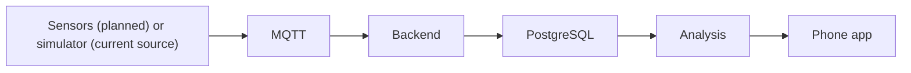

<div align="center">

# MechSense

**Catch the fault. Confirm the fix.**

An AI-assisted predictive-maintenance assistant for an industrial motor test rig.

</div>


## Status

MechSense is a software MVP validated on simulated data only. Hardware integration and real-motor testing are the next step. Real sensors, ESP32 firmware, real-motor testing, calibration, the knowledge base, RAG, and automatic case promotion are not built.

## How it works



## Features

| Area | What it does |
| --- | --- |
| Sensing and data | Validated readings over MQTT, stored in PostgreSQL, live updates over WebSocket, latest-reading API with freshness flag. Every reading labelled simulated or sensor. |
| Analysis | Four fault signatures (vibration rise, overheating, abnormal load, speed deviation); possible causes with checks to run, never a confirmed cause. |
| Repair and verification | Approved repair steps only; PASS, FAIL, or INCONCLUSIVE from post-repair readings against a baseline. |
| Reporting | Case report in JSON or text; a repair is shown as verified only on a PASS. |

## Mobile app

| Screen | Purpose |
| --- | --- |
| Welcome | Starts the application and checks backend connectivity. |
| Live Monitor | Displays live telemetry with simulated data labeling and staleness warnings. |
| Diagnosis | Displays possible causes with supporting evidence and checks to run. |
| Repair guide | Displays approved repair steps for detected fault signatures. |
| Verification | Shows post-repair verification results and uncertainty statements. |
| Report | Summarises case details, verified repair outcomes, and diagnostic notes. |

The phone performs no diagnosis or repair logic and stores nothing on the device. Note that the repair guide currently shows "no approved procedure" because no procedures are approved yet.

## Not yet built

- Real sensors and ESP32 firmware
- Real-motor calibration
- Knowledge base
- Retrieval-augmented generation (RAG)
- Automatic promotion of verified cases

## Repository layout

```
backend/          Node.js and Express API, MQTT ingestion, WebSocket broadcast, and analysis
backend/scripts/  Local development stack and demo seed scripts
ai-service/       Python and FastAPI service (health endpoint only)
database/         PostgreSQL schema definitions and migrations
mobile/           React Native mobile application running on Expo
firmware/         ESP32 sensor firmware (not started)
docs/             Project documentation and progress history
```

## Getting started

Run all commands in PowerShell.

### Backend tests
```powershell
cd backend
npm test
```
No system database needed.

### Local development stack
Set `$env:MECHSENSE_DEV_DB_PASSWORD` to a local password you choose, then run the stack:
```powershell
cd backend
$env:MECHSENSE_DEV_DB_PASSWORD = "<choose-local-password>"
npm run dev:stack
```
Do not commit the password. Leave this process running; it prints the database connection string and MQTT broker URL.

### Demo case
Set `$env:DATABASE_URL` to the connection string the stack prints, then run the seed script:
```powershell
cd backend
$env:DATABASE_URL = "<connection-string-from-stack>"
npm run db:seed-demo
```

### Backend server
Set `$env:DATABASE_URL` and `$env:MQTT_URL` to the values printed by the stack, then start the server:
```powershell
cd backend
$env:DATABASE_URL = "<connection-string-from-stack>"
$env:MQTT_URL = "<broker-url-from-stack>"
npm start
```

### Mobile app
Set up local settings before starting:
- The backend address goes in `mobile/src/config.js`.
- The case ID goes in `mobile/src/monitorSettings.js`.
- Both stay on your machine and are never committed.

Start Expo:
```powershell
cd mobile
npx expo start -c
```
Scan the QR code with Expo Go on the same Wi-Fi network.

## Troubleshooting

| Symptom | Likely cause | Fix |
| --- | --- | --- |
| "Cannot reach backend" | Phone and PC on different networks, or wrong address in config.js | Same Wi-Fi, check the address with ipconfig. |
| Expo "failed to download remote update" | Windows Firewall blocking port 8081, or weak Wi-Fi | Allow port 8081 and 3000 in Windows Firewall; set the network profile to Private; move closer to the router. |
| "No case selected" | CASE_ID not set | Run the demo seed and set CASE_ID locally. |

## Limitations

- **Simulated data only**: Validated on simulated data only; no claims are made regarding accuracy, detection rates, or real-world performance.
- **Placeholder thresholds**: Detection and baseline thresholds are placeholders and have not been calibrated on a physical motor.
- **Four fault signatures only**: Analysis detects vibration rise, overheating, abnormal load, and speed deviation only.
- **Verification scope**: A PASS means the four signatures are absent relative to the baseline, not that the cause was repaired. No repair has been verified on hardware.
- **Repair guidance empty**: Repair guidance is empty until a person approves procedures.

## Documentation

See docs/PROGRESS.md for the detailed status and history.

## Licence

To be confirmed.
